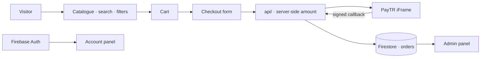

<div align="center">



<p>
  <a href="https://efemiletisim.com/"></a>
  
  
  
</p>

<p><em>A fast e-commerce store for smartwatches, earbuds and tablet accessories,<br>
built with vanilla JavaScript and Firebase on static hosting.</em></p>

<table>
  <tr>
    <td width="50%"></td>
    <td width="50%"></td>
  </tr>
  <tr>
    <td width="50%"></td>
    <td width="50%"></td>
  </tr>
</table>

</div>


## Features

| | |
|---|---|
| **Catalogue** | Filter by category (smartwatches, earbuds, accessories, audio) and brand, price range, rating, and sort. |
| **Live search** | Instant product and brand search from the navigation bar. |
| **Product detail** | Gallery, specification table, related products and stock status. |
| **Cart and checkout** | Quantity updates, coupon support, address and invoice forms, and a PayTR iFrame payment. Card details are never collected on the site; the amount is calculated on the server and the result is written from PayTR's signed callback. |
| **Accounts** | Firebase Authentication with email verification, order and favourite history in Firestore. |
| **Account panel** | Orders, favourites, addresses and profile, including account deletion. |
| **Admin panel** | Product, order and settings management. |
| **Single source of truth** | Brand, contact and legal details all come from one config file. |
| **SEO and legal** | A dynamic sitemap from the live catalogue, schema.org markup, privacy (KVKK), distance-selling and returns pages. |




## Türkçe özet

**Efem İletişim**, akıllı saat, kulaklık ve tablet aksesuarları satan hızlı bir e-ticaret sitesi. Vanilla JavaScript ve Firebase ile yazıldı, statik hosting üzerinde çalışıyor. Katalog ve filtreler, canlı arama, sepet, PayTR ile güvenli ödeme, e-posta doğrulamalı üyelik, hesap paneli ve yönetim paneli içeriyor. Bu depo, sitenin asıl deposunun bir fork'u; adres senkronu, üyelik ve sipariş eksikleri, admin paneli ve karanlık mod gibi geliştirmelerde katkım var.


## Development

```sh
cp .env.example .env
node dev-server.js            # local static server with API routes
npm run sync-catalog          # sync the product catalogue
```

<div align="center">
<br>
<a href="https://github.com/kutluhangil"></a>
<sub>Fork of <a href="https://github.com/cemalcingirlar/efemiletisim.com">cemalcingirlar/efemiletisim.com</a> · contributions by kutluhangil.</sub>
</div>
