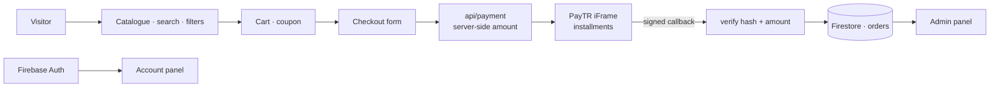

<div align="center">


<p>
  <a href="https://efemiletisim.com/"></a>
  
  
  
</p>

<p><em>A fast e-commerce store for smartwatches, earbuds and tablet accessories,<br>
built with vanilla JavaScript and Firebase on static hosting, with serverless API routes for money.</em></p>

<table>
  <tr>
    <td width="50%"></td>
    <td width="50%"></td>
  </tr>
  <tr>
    <td width="50%"></td>
    <td width="50%"></td>
  </tr>
</table>

</div>


## The idea

A small electronics shop needs a store that loads instantly on a phone, is easy for the owner to update, and handles payment without ever touching a card number. Efem İletişim is plain HTML, CSS and JavaScript on static hosting with Firebase for accounts and data, plus a handful of serverless routes where trust matters: prices, coupons, orders and the payment callback.

> **The browser never decides the price.** The checkout sends product ids and a coupon code; the server reads the real prices from the catalogue, applies the coupon, and asks PayTR for an iFrame token. The order is marked paid only when PayTR's signed callback arrives and its amount matches.


## Features

| | |
|---|---|
| **Catalogue** | Filter by category (smartwatches, earbuds, accessories, audio) and brand, price range and rating, and sort. |
| **Live search** | Instant product and brand search from the navigation bar. |
| **Product detail** | Gallery, specification table, related products and stock status. |
| **Cart and coupons** | Quantity updates; coupons are validated on the server. |
| **Checkout** | Address (all 81 provinces, with autocomplete) and invoice forms, then a PayTR iFrame with installment options, or bank transfer with a receipt upload. |
| **Accounts** | Firebase Authentication with email verification; orders, favourites, addresses and profile in an account panel, including account deletion. |
| **Admin panel** | Products (with a barcode list to pick from), orders and their status, coupons and site settings. |
| **Dark mode** | A theme that is set before first paint, so pages never flash. |
| **Single source of truth** | Brand, contact and legal details all come from one config file. |
| **SEO and legal** | A dynamic sitemap from the live catalogue, schema.org markup, privacy (KVKK), distance sales, pre-information and returns pages. |
| **Scripted checks** | Catalogue sync and audit, barcode sync, and test scripts for payment, installments, orders and stock. |


## How a payment works




## My contributions

This repository is a fork of the shop's main repository. My work on it:

| | |
|---|---|
| **Redesign** | A new high-end visual design for the storefront, the legal pages and the project docs and config. |
| **Admin and orders** | Dark mode, an upgraded admin panel and order management, and new product visuals. |
| **Accounts and orders** | Addresses, invoices, bank-transfer receipts, account deletion and the email setup. |
| **Addresses** | Address syncing between profile and checkout, all 81 provinces, autocomplete and an admin settings tab. |
| **Details** | Real partner logos, company tax and KEP lines on the about page, and Firebase email language. |


## Türkçe özet

**Efem İletişim**, akıllı saat, kulaklık ve tablet aksesuarları satan hızlı bir e-ticaret sitesi. Vanilla JavaScript ve Firebase ile yazıldı, statik hosting üzerinde çalışıyor; fiyat, kupon, sipariş ve ödeme geri çağrısı gibi para işleri sunucu tarafındaki API rotalarında. Katalog ve filtreler, canlı arama, sepet ve kupon, PayTR ile taksitli güvenli ödeme veya havale dekontu, e-posta doğrulamalı üyelik, hesap paneli, yönetim paneli ve karanlık mod var. Bu depo sitenin asıl deposunun bir fork'u; yeniden tasarım, admin paneli, üyelik ve sipariş eksikleri ve adres senkronu gibi geliştirmelerde katkım var.


## Development

```sh
cp .env.example .env
node dev-server.js            # local static server with the API routes
npm run sync-catalog          # sync the product catalogue
npm run test:payment          # payment library and flow checks
```

The API routes read `FIREBASE_SERVICE_ACCOUNT`, `FIREBASE_STORAGE_BUCKET`, `ADMIN_EMAILS`, `ORDER_TOKEN_SECRET`, `SITE_BASE_URL` and the PayTR settings (`PAYTR_MERCHANT_ID`, `PAYTR_MERCHANT_KEY`, `PAYTR_MERCHANT_SALT`, `PAYTR_TEST_MODE`, `PAYTR_MAX_INSTALLMENT`, `PAYTR_NO_INSTALLMENT`).

```
*.html          storefront, product, cart, checkout, account, admin and legal pages
js/             cart, products, auth, payment, installments, theme, site config
api/            catalog, coupon, order, payment, admin (serverless)
scripts/        catalogue and barcode sync, audits, test scripts
firestore.rules · storage.rules
```

<div align="center">
<br>
<a href="https://github.com/kutluhangil"></a>
<sub>Fork of <a href="https://github.com/cemalcingirlar/efem2">cemalcingirlar/efem2</a> · contributions by kutluhangil · products and prices in the banner are invented.</sub>
</div>
